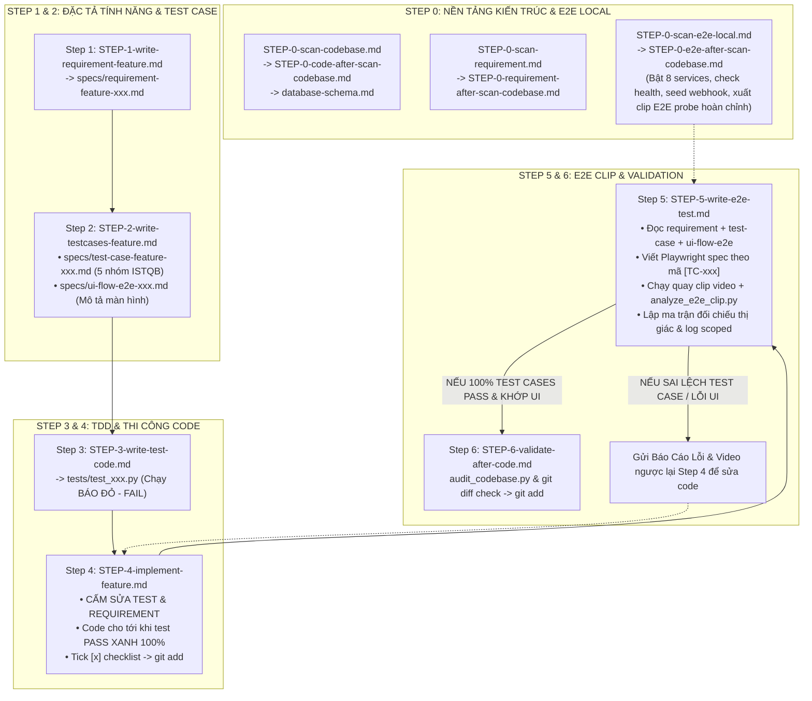

# 🚀 BỘ KỸ NĂNG & CÔNG CỤ PHÁT TRIỂN TỰ ĐỘNG (SKILL CODE SUITE)

> **Thư mục trung tâm:** Chứa toàn bộ **11 Cẩm Nang Kỹ Năng (Skills)** và **6 Công Cụ Tự Động Hóa (Scripts)** điều phối toàn bộ chu trình phát triển phần mềm chuẩn mực từ **Step 0 đến Step 6**.
>
> 💡 **Khởi động trên máy mới (One-Click Setup):** Chỉ cần chạy lệnh `./setup` (hoặc `./setup.sh`) tại thư mục gốc để tự động cài đặt Node.js, FFMPEG, Chromium, Playwright và Midscene AI!

---

## 🗺️ Bản Đồ Quy Trình 7 Bước (Pipeline Architecture)

---

## 📂 Danh Mục 9 Meta-Skills Cốt Lõi (Dùng Chung Mọi Dự Án)

> 💡 **Lưu ý:** Các file cẩm nang thực tế (`STEP-0-*-after-scan-*.md`) sẽ **tự động được sinh ra** sau khi bạn chạy quét Bước 0 trên dự án cụ thể.

| Bước | Tên File Skill | Vai Trò & Chức Năng |
| :---: | :--- | :--- |
| **0.1** | [`STEP-0-scan-codebase.md`](STEP-0-scan-codebase.md) | Meta-Skill quét AST & xuất `database-schema.md` qua Repomix |
| **0.2** | [`STEP-0-scan-requirement.md`](STEP-0-scan-requirement.md) | Meta-Skill quét toàn bộ tài liệu, rules & bóc tách State Machine domain |
| **0.3** | [`STEP-0-scan-e2e-local.md`](STEP-0-scan-e2e-local.md) | Meta-Skill khảo sát E2E local, tự động nhận diện services và xuất clip probe |
| **1** | [`STEP-1-write-requirement-feature.md`](STEP-1-write-requirement-feature.md) | Soạn thảo User Story & Hợp đồng dữ liệu `specs/requirement-feature-<mô tả>.md` |
| **2** | [`STEP-2-write-testcases-feature.md`](STEP-2-write-testcases-feature.md) | Sinh ma trận 5 nhóm ISTQB `test-case-feature` & file đặc tả màn hình `ui-flow-e2e` |
| **3** | [`STEP-3-write-test-code.md`](STEP-3-write-test-code.md) | Sinh code Unit & Integration Test `tests/test_xxx.py` (Chạy báo ĐỎ - FAIL) |
| **4** | [`STEP-4-implement-feature.md`](STEP-4-implement-feature.md) | Kỹ sư thi công: CẤM SỬA TEST, đọc `database-schema.md`, code cho tới khi test XANH |
| **5** | [`STEP-5-write-e2e-test.md`](STEP-5-write-e2e-test.md) | Viết Playwright E2E bám sát Test Case & Requirement, quay clip video, bóc tách 1 FPS và feedback |
| **6** | [`STEP-6-validate-after-code.md`](STEP-6-validate-after-code.md) | Rà soát Git Diff, phát hiện vi phạm kiến trúc, đảm bảo sạch trước commit |

---

## 🛠️ Công Cụ Cài Đặt & Bộ Scripts Tự Động Hóa

### 1. Script Cài Đặt Toàn Bộ Phụ Thuộc (One-Click Setup)
* [`setup.sh`](setup.sh) (hoặc `./setup`): Tự động cài đặt 100% phụ thuộc cho bất kỳ máy mới nào (Python `pytest`, Node.js, `repomix`, `ffmpeg` bóc tách video 1 FPS, Playwright, Chromium Browser và Midscene AI).

### 2. Danh Mục 7 Công Cụ Tự Động Hóa (`scripts/`)

| File Script | Cách Sử Dụng | Chức Năng |
| :--- | :--- | :--- |
| [`scripts/scan_codebase.py`](scripts/scan_codebase.py) | `python3 scripts/scan_codebase.py` | Quét AST, nén skeleton và thống kê 12 bảng định lượng |
| [`scripts/scan_requirements.py`](scripts/scan_requirements.py) | `python3 scripts/scan_requirements.py` | Thu hoạch tài liệu rules và bóc tách domain entities |
| [`scripts/run_e2e_local.py`](scripts/run_e2e_local.py) | `python3 scripts/run_e2e_local.py --check-services` `python3 scripts/run_e2e_local.py --spec e2e/auth.spec.ts` | Kiểm tra trạng thái cổng local, chạy Playwright có cờ quay clip `--video=on`, lưu video vào `artifacts/videos/` |
| [`scripts/analyze_e2e_clip.py`](scripts/analyze_e2e_clip.py) | `python3 scripts/analyze_e2e_clip.py --video <clip.webm> --feature <name>` | Bóc tách keyframes 1 FPS qua ffmpeg + Lọc sạch 100% log rác background, chỉ giữ log riêng của feature |
| [`scripts/seed_webhook.py`](scripts/seed_webhook.py) | `python3 scripts/seed_webhook.py --target all` hoặc `--url <url>` | Bắn dữ liệu mẫu mock webhook / event vào Backend & Microservices (hỗ trợ tùy biến URL & payload) |
| [`scripts/run_unit_tests.py`](scripts/run_unit_tests.py) | `python3 scripts/run_unit_tests.py` | Chạy bộ Unit/Integration Test, hiển thị rõ ràng trạng thái ĐỎ (FAIL) hoặc XANH (PASS) |
| [`scripts/audit_codebase.py`](scripts/audit_codebase.py) | `python3 scripts/audit_codebase.py` | Quét siêu tốc 0.05s toàn bộ Git Diff đối chiếu với điều luật cấm kỵ |
