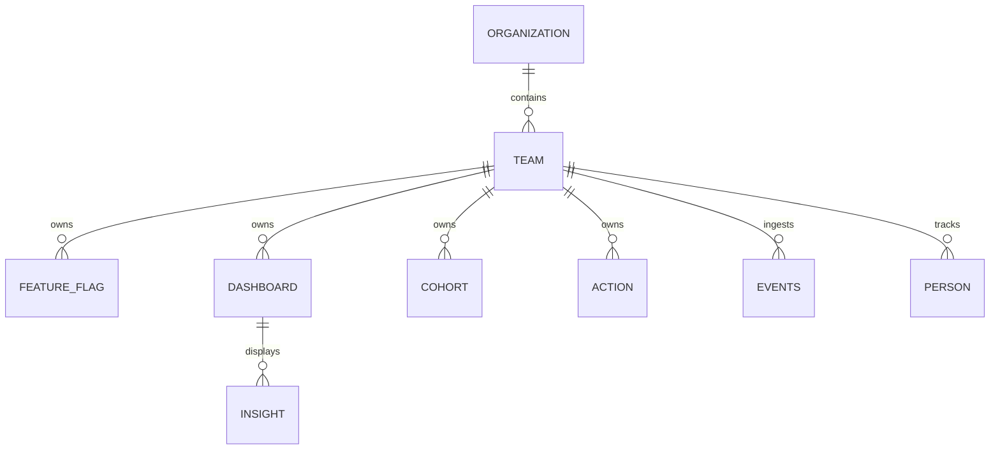

# Kỹ Năng Tổng Quan Đọc, Phân Tích & Sửa Codebase (Universal Codebase Overview Skill)

> **Mục đích:** Tài liệu này được thiết kế như một **Bộ Kỹ Năng Khung (Overview Skill Framework)**. Bạn có thể sử dụng trực tiếp trên repository hiện tại (lấy kiến trúc PostHog làm Case Study chuẩn mực) hoặc **sao chép sang bất kỳ dự án phần mềm nào khác** để hướng dẫn AI cách đọc, phân tích và sửa code mà không làm phá vỡ kiến trúc hệ thống.

---

## 0. Quy Tắc Sống Còn: Cơ Chế Ủy Quyền Cho Subagent (Subagent Delegation Pattern)

> [!IMPORTANT]
> ### CHỐNG TRÀN VÀ Ô NHIỄM NGỮ CẢNH (CONTEXT BLOAT & WINDOW PRESERVATION)
> Khi làm việc trên các codebase lớn (hàng nghìn file hoặc các file khung xương/phân tích nặng hàng chục MB):
> 
> 1. **Session chính luôn đóng vai trò Orchestrator (Tổng chỉ huy):**
>    - Tuyệt đối **KHÔNG** đọc toàn văn các file dữ liệu thô lớn (`codebase-skeleton.md`, file phân tích hàng nghìn dòng, hoặc log quét đồ sộ) vào Context của Session chính.
> 2. **Ủy quyền việc nặng cho Subagent (`invoke_subagent`):**
>    - Khi cần đọc sâu tài liệu phân tích, tổng hợp nhiều file mẫu, hoặc viết tài liệu kỹ thuật dài, Session chính **bắt buộc khởi tạo Subagent độc lập**.
>    - Subagent chạy trong ngữ cảnh riêng (Isolated Context), đọc file, viết mã nguồn hoặc tài liệu trực tiếp xuống đĩa bằng `write_file`.
>    - Khi hoàn thành, Subagent chỉ gửi tin nhắn tóm tắt ngắn (3–5 gạch đầu dòng) về cho Session chính.
> 3. **Lợi ích:** Session chính luôn giữ được **95%+ Context Window rảnh rỗi**, tránh hoàn toàn hiện tượng quên lệnh (Attention Dilution) hoặc sập phiên làm việc (Out of Tokens).

---

## 1. Phương Pháp Khảo Sát & Định Vị Codebase (Codebase Discovery & Where-To-Write)

Khi bước vào bất kỳ dự án nào (dù là Monorepo, Modular Monolith hay Microservices phân tán), AI phải định vị mã nguồn theo khuôn mẫu **Vertical Slices / Domain Modules**:

### 1.1. Bản Đồ Phân Tầng Chuẩn Của 1 Feature Module
Mỗi tính năng hoàn chỉnh của hệ thống nên được tổ chức khép kín theo cấu trúc mô-đun chuẩn mực:

```
<domain_hoac_product_module>/
├── manifest.(tsx|ts|json)           # Khai báo URLs, Route bindings, Menu & Navigation
├── backend/                         # Tầng xử lý logic & dữ liệu phía Server
│   ├── models.(py|ts|go|rs)         # Định nghĩa cấu trúc bảng Database (Bắt buộc Tenant Scoped)
│   ├── routes.(py|ts)               # Khai báo và đăng ký URL Endpoints với Router trung tâm
│   ├── presentation/                # Tầng tiếp nhận HTTP Request (Controllers / ViewSets & Serializers)
│   ├── facade/                      # Cổng giao tiếp công khai duy nhất cho Module khác gọi sang
│   │   ├── contracts.(py|ts)        # DTOs / Schemas truyền nhận dữ liệu bất biến (@frozen)
│   │   └── api.(py|ts)              # Các hàm Service công khai trả về DTOs
│   ├── tasks/                       # Tác vụ chạy ngầm bất đồng bộ (Celery / BullMQ / Workers)
│   └── tests/                       # Unit test & Integration test của riêng module này
└── frontend/                        # Tầng giao diện người dùng
    ├── <Name>Scene.(tsx|vue)        # Màn hình giao diện chính (View Entrypoint)
    ├── <name>Logic.(ts|js)          # Quản lý State/Nghiệp vụ (tách biệt 100% khỏi component view)
    └── generated/                   # Mã nguồn sinh tự động từ API Schema (CẤM SỬA TAY)
```

### 1.2. Bảng Tra Cứu Nhanh: "Muốn Viết X Thì Mở File Nào & Wiring Ở Đâu?"

| Khi bạn cần thêm hoặc sửa... | Vị trí File cần Tạo / Chỉnh Sửa | Điểm Đăng Ký Trung Tâm (Wiring Registry) |
| :--- | :--- | :--- |
| **1. Bảng Database mới** | `models.(py|ts)` trong module nghiệp vụ | Chạy công cụ migration & kiểm tra phân quyền scope |
| **2. API Endpoint mới** | `presentation/views` hoặc `controllers/` | File `routes` của module và Router trung tâm của ứng dụng |
| **3. Hàm chia sẻ cho module khác** | `facade/contracts` (DTO) + `facade/api` | Xuất qua `facade/__init__` hoặc `facade/index.ts` |
| **4. Tác vụ chạy nền (Background Job)** | `tasks/` hoặc `workflows/` của module | Đăng ký worker queue trung tâm |
| **5. Màn hình giao diện & State** | `<Name>Scene.tsx` & `<name>Logic.ts` | Khai báo URL route trong `manifest` hoặc `urls.ts` |

---

### 1.3. Bản Đồ Database & Hướng Dẫn Đọc Dữ Liệu Trước Khi Code (Database Schema Guide)

> [!IMPORTANT]
> **NGUYÊN TẮC: TUYỆT ĐỐI KHÔNG CODE MỜ TÊN BẢNG HOẶC TRƯỜNG DỮ LIỆU!**
> Trước khi viết bất kỳ câu query ORM, SQL, hay thêm trường mới vào model:
> 1. AI **BẮT BUỘC** mở file [`database-schema.md`](file:///Users/macos/Desktop/phongvan/python/github%20project%20microservices/database-schema.md) để tra cứu chính xác tên bảng thật (`db_table`), các trường khóa chính, khóa ngoại và cờ `team_id`.
> 2. Phân biệt rõ ràng hệ thống Dual-Database của dự án:
>    - **PostgreSQL (Django ORM):** Lưu trữ 737 bảng quan hệ (Users, Teams, FeatureFlags, Cohorts, Dashboards, Permissions). Bắt buộc truy vấn qua ORM và scope theo `team_id`.
>    - **ClickHouse (Analytical Data):** Lưu trữ hơn 1.600 bảng dữ liệu sự kiện phân tích (`events`, `sharded_events`, `person`, `session_recording_events`). CẤM query trực tiếp bằng SQL trần, bắt buộc thông qua HogQL hoặc API Client chuyên dụng.
>    - **Redis:** Lưu Cache, Task Queues và Rate Limits.

#### Bảng Tra Cứu Thực Thể Dữ Liệu Cốt Lõi (Core Entity Reference)
| Thực Thể (Model) | Tên Bảng Thật (`db_table`) | Hệ Quản Trị DB | Phạm Vi Multi-Tenant | Quan Hệ Khóa Ngoại |
| :--- | :--- | :---: | :---: | :--- |
| `Organization` | `posthog_organization` | PostgreSQL | Khóa Tổ chức Root | Cha của tất cả các Teams |
| `Team` | `posthog_team` | PostgreSQL | **TRỌNG TÂM TENANT** | `organization_id -> Organization` |
| `User` | `posthog_user` | PostgreSQL | Global Identity | Người dùng đăng nhập |
| `FeatureFlag` | `posthog_featureflag` | PostgreSQL | ✅ Bắt buộc `team_id` | `team_id -> Team` |
| `Cohort` | `posthog_cohort` | PostgreSQL | ✅ Bắt buộc `team_id` | `team_id -> Team` |
| `Action` | `posthog_action` | PostgreSQL | ✅ Bắt buộc `team_id` | `team_id -> Team` |
| `Dashboard` | `posthog_dashboard` | PostgreSQL | ✅ Bắt buộc `team_id` | `team_id -> Team` |
| `Insight` | `posthog_dashboarditem` | PostgreSQL | ✅ Bắt buộc `team_id` | `team_id -> Team`, `dashboard_id -> Dashboard` |
| `Event` | `events` / `sharded_events` | ClickHouse | ✅ Bắt buộc `team_id` | Dòng sự kiện người dùng |
| `Person` | `person` / `person_distinct_id` | ClickHouse | ✅ Bắt buộc `team_id` | Định danh người dùng theo Tenant |

#### Sơ Đồ Quan Hệ Thực Thể Cốt Lõi (Core ERD)


---

## 2. Các Bất Biến Kỹ Thuật Bắt Buộc (Universal Engineering Invariants)

Bất kỳ dự án nào có yếu tố nhiều người dùng hoặc dịch vụ phân tán đều phải tuân thủ nghiêm ngặt 5 bất biến sau:

### 2.1. Phân Lập Multi-Tenancy & Chống Lỗ Hổng IDOR (Bắt Buộc Hàng Đầu)
- **Mọi bản ghi dữ liệu người dùng phải có khóa định danh Tenant:** Ví dụ `team_id`, `org_id` hoặc `tenant_id`.
- **Tuyệt đối không truy vấn dữ liệu toàn cục (Unscoped Query):**
  - Không bao giờ dùng `Model.objects.get(id=...)` trần hoặc `SELECT * FROM table WHERE id = ...`.
  - Bắt buộc phải ràng buộc điều kiện: `Model.objects.for_team(team).filter(id=...)` hoặc `WHERE team_id = :team_id AND id = :id`.

### 2.2. Dữ Liệu Danh Tính Người Dùng Phải Đi Qua Dịch Vụ Định Danh (Identity RPC)
- Trong các hệ thống lớn, bảng lưu trữ người dùng và định danh thiết bị (`persons`, `users`, `distinct_ids`) được sharding hoặc quản lý bởi service riêng. Cấm query trực tiếp SQL ORM vào bảng identity gốc; bắt buộc gọi qua RPC Client chuyên dụng.

### 2.3. Nguyên Tắc "Thin Entrypoints" & Phạm Vi Giao Dịch Nhỏ (Scoped Transactions)
- **Thin Entrypoints:** Controller, API ViewSet, HTTP Handler hoặc Background Task chỉ làm nhiệm vụ parse input, xác thực quyền, gọi hàm Service xử lý và format kết quả trả về.
- **Không bật tự động bọc Transaction cho toàn bộ Request (`ATOMIC_REQUESTS = False`):**
  - Chỉ bọc `transaction.atomic()` quanh đúng các câu lệnh ghi DB cần tính toàn vẹn (ACID).
  - Tuyệt đối không để lệnh gọi HTTP bên thứ ba hoặc hàm đọc dữ liệu nặng nằm bên trong khối transaction.

### 2.4. Tính Bất Biến Của Dữ Liệu Truyền Nhận (Frozen DTOs)
- Mọi Data Transfer Object (DTO) dùng để giao tiếp giữa các tầng hoặc giữa các module phải được đóng băng tính đột biến (`@frozen` hoặc `Object.freeze()`).

### 2.5. Kiểm Soát Gọi Mạng Ra Bên Ngoài (Egress Gating)
- Mọi cuộc gọi HTTP ra internet (Slack, GitHub, Webhook đối tác) phải đi qua module trung chuyển (Egress Proxy) để chặn IP nội bộ độc hại (SSRF protection), thiết lập timeout và đo lường metrics.

---

## 3. Khuôn Mẫu Code Chuẩn Theo Từng Tầng Công Nghệ (Tech Stack Patterns)

> [!NOTE]
> **Phân Định Trách Nhiệm Công Nghệ (Separation of Tech Stacks):**
> Trong hệ thống Microservices này, **KHÔNG CÓ VIỆC VIẾT CODE TRÙNG LẶP SONG SONG**. Mỗi ngôn ngữ đảm nhiệm một tầng chuyên biệt:
> - **Python (Django / DRF):** Dành riêng cho **Tầng Backend API, Logic Nghiệp Vụ & PostgreSQL ORM**.
> - **TypeScript / Node.js:** Dành riêng cho **Tầng Ingestion Pipeline (ClickHouse) & Frontend Giao Diện (React / Kea)**.
> Khi phát triển ở tầng nào, lập trình viên/AI chỉ áp dụng đúng khuôn mẫu của tầng đó:

### 3.1. Truy Vấn Scoped Multi-Tenant An Toàn (Chống Lỗ Hổng IDOR)

#### Cho Backend API (Python / Django)
```python
# backend/services/feature_service.py
from typing import Optional
from posthog.models.team.team import Team
from products.early_access_features.backend.models import EarlyAccessFeature

def get_feature_by_id(team: Team, feature_id: str) -> Optional[EarlyAccessFeature]:
    """
    LUẬT: Luôn dùng objects.for_team() hoặc filter(team=team).
    CẤM TUYỆT ĐỐI: EarlyAccessFeature.objects.get(id=feature_id)
    """
    return EarlyAccessFeature.objects.for_team(team).filter(id=feature_id).first()
```

#### Node.js / TypeScript (Streaming Ingestion & Database Services)
```typescript
// nodejs/src/services/event-service.ts
import { ClickHouseClient } from '@clickhouse/client'

export interface EventFilter {
    teamId: number
    distinctId: string
    limit?: number
}

export async function queryScopedEvents(
    client: ClickHouseClient,
    filter: EventFilter
): Promise<Array<Record<string, unknown>>> {
    // LUẬT: Luôn liên kết tham số teamId vào câu query để cô lập dữ liệu
    const sql = `
        SELECT event, timestamp, properties
        FROM sharded_events
        WHERE team_id = {teamId:Int64} AND distinct_id = {distinctId:String}
        ORDER BY timestamp DESC
        LIMIT {limit:Int32}
    `
    const result = await client.query({
        query: sql,
        query_params: {
            teamId: filter.teamId,
            distinctId: filter.distinctId,
            limit: filter.limit || 50,
        },
        format: 'JSONEachRow',
    })
    return await result.json()
}
```

---

### 3.2. Chuẩn Hóa Bắt Lỗi & Định Dạng Ngoại Lệ (Standardized Exception Handling)

#### Python (Django / DRF)
```python
# backend/common/exceptions.py
from rest_framework import status
from rest_framework.exceptions import APIException
from posthog.exceptions import generate_exception_response

class QuotaExceededException(APIException):
    status_code = status.HTTP_402_PAYMENT_REQUIRED
    default_code = "quota_exceeded"
    default_detail = "Tổ chức của bạn đã dùng hết hạn mức tài nguyên trong chu kỳ này."

def format_service_error(endpoint: str, error_message: str, field: str):
    """Chuẩn hóa response lỗi dạng JSON: { type, code, detail, attr }"""
    return generate_exception_response(
        endpoint=endpoint,
        detail=error_message,
        code="invalid_request",
        type="validation_error",
        attr=field,
        status_code=400,
    )
```

#### Node.js / TypeScript (Express / Fastify / Workers)
```typescript
// nodejs/src/common/errors/api-error.ts
import { Response } from 'express'
import { statsd } from '~/common/metrics'

export class CustomApiError extends Error {
    constructor(
        public message: string,
        public statusCode: number = 400,
        public code: string = 'invalid_request',
        public attr: string | null = null
    ) {
        super(message)
        this.name = 'CustomApiError'
    }
}

export function handleStandardErrorResponse(
    res: Response,
    endpoint: string,
    error: unknown
): Response {
    if (error instanceof CustomApiError) {
        statsd.increment('api_handled_error_total', { endpoint, code: error.code })
        return res.status(error.statusCode).json({
            type: error.statusCode >= 500 ? 'server_error' : 'validation_error',
            code: error.code,
            detail: error.message,
            attr: error.attr,
        })
    }

    statsd.increment('api_unhandled_error_total', { endpoint })
    return res.status(500).json({
        type: 'server_error',
        code: 'unexpected_error',
        detail: 'An internal server error occurred.',
        attr: null,
    })
}
```

---

### 3.3. Structured Logging Đồng Bộ Distributed Tracing Context

#### Python (structlog + OpenTelemetry)
```python
import structlog
from opentelemetry import trace

logger = structlog.get_logger(__name__)

def log_event_action(team_id: int, action_name: str, **extra_data):
    span = trace.get_current_span()
    ctx = span.get_span_context()
    
    # Tự động đính kèm trace_id và span_id thống nhất với Loki / Grafana
    logger.info(
        "action_performed",
        action=action_name,
        team_id=team_id,
        trace_id=f"{ctx.trace_id:032x}" if ctx.is_valid else None,
        span_id=f"{ctx.span_id:016x}" if ctx.is_valid else None,
        **extra_data,
    )
```

#### Node.js / TypeScript (pino + OpenTelemetry)
```typescript
import { trace, isSpanContextValid } from '@opentelemetry/api'
import pino from 'pino'

const pinoLogger = pino({
    formatters: {
        level: (label) => ({ level: label }),
    },
})

export function logAction(
    actionName: string,
    teamId: number,
    extra: Record<string, unknown> = {}
): void {
    const activeSpan = trace.getActiveSpan()?.spanContext()
    const traceData = activeSpan && isSpanContextValid(activeSpan)
        ? { trace_id: activeSpan.traceId, span_id: activeSpan.spanId }
        : {}

    pinoLogger.info({
        msg: 'action_performed',
        action: actionName,
        team_id: teamId,
        ...extra,
        ...traceData,
    })
}
```

---

## 4. Quy Chuẩn Giao Diện & Frontend State Management

1. **Tách Rời Hoàn Toàn State Khỏi View Component:**
   - Mọi nghiệp vụ tải dữ liệu (fetch), cache, submit form, biến đổi logic phải nằm trong file quản lý trạng thái (`*Logic.ts` hoặc custom store). Component `.tsx` chỉ làm nhiệm vụ render giao diện và bắt sự kiện.
2. **Chống Gửi Yêu Cầu Kép (Double Submission Prevention):**
   - Mọi nút bấm (`Button`) kích hoạt request API lên server đều phải có cờ `loading` và `disabledReason`:
   ```tsx
   <LemonButton
       type="primary"
       onClick={() => submitAction()}
       loading={isSubmitting}
       disabledReason={isSubmitting ? 'Request in flight...' : undefined}
   >
       Lưu Thay Đổi
   </LemonButton>
   ```
3. **Responsive Dựa Trên Container Queries:**
   - Trong ứng dụng web có side-panel hoặc navigation thu gọn, khung nhìn nội dung có thể co lại chỉ còn ~520px. Bắt buộc dùng `@container` queries hoặc cấu trúc linh hoạt (wrap / stack), không phụ thuộc vào media breakpoint cứng của toàn màn hình (`md:`, `lg:`).

---

## 5. Quy Trình Kiểm Thử, Linting & Commit

- **Kiểm Thử Cục Bộ:**
  - Chạy test có mục tiêu cho đúng file vừa sửa: `hogli test <file_path>` (hoặc lệnh test tương ứng của dự án).
  - Đảm bảo mỗi bài test mới đều bắt trúng một lỗi hồi quy thực tế (realistic regression).
- **Linter & Formatter:**
  - Python: `ruff check . --fix` và `ruff format .`.
  - Frontend / TypeScript: `oxlint` hoặc `eslint`, `oxfmt` hoặc `prettier`.
- **Chuẩn Hóa Thông Điệp Commit (Conventional Commits):**
  - Cú pháp: `<type>(<scope>): <mô tả ngắn>`
  - Ví dụ: `feat(feature-flags): add multi-property targeting`, `fix(ingestion): handle null payload in kafka consumer`.

---

> [!NOTE]
> **Khâu Kiểm Duyệt Tự Động Sau Khi Code:**
> Toàn bộ việc kiểm tra các bất biến kiến trúc trên Git Diff đã được tự động hóa 100% bằng script [`scripts/audit_codebase.py`](scripts/audit_codebase.py) theo quy trình trong [`skills/STEP-6-validate-after-code.md`](skills/STEP-6-validate-after-code.md). AI thực thi script tự động, không cần rà soát thủ công bằng mắt.
