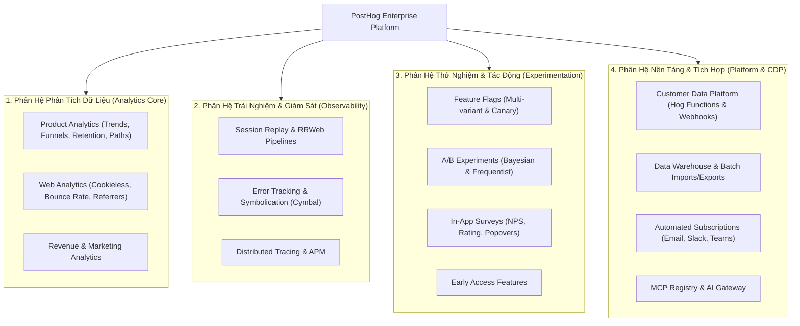
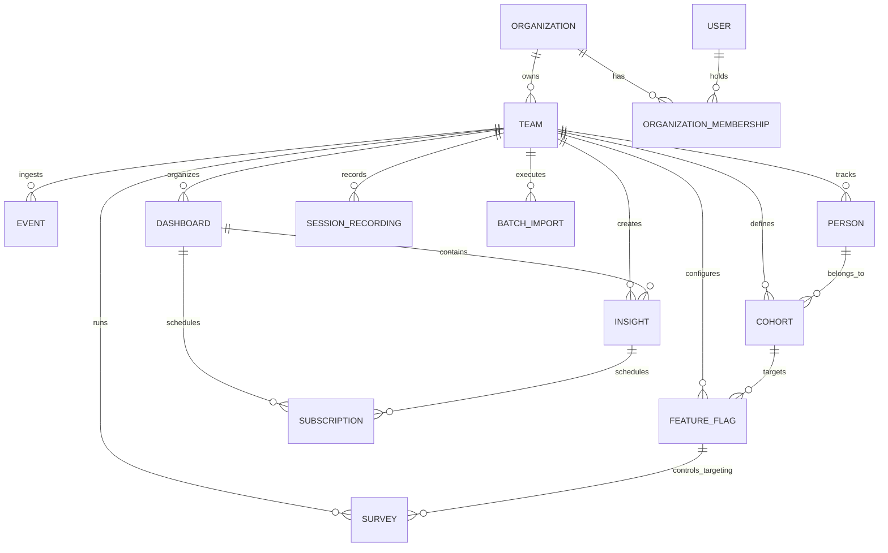
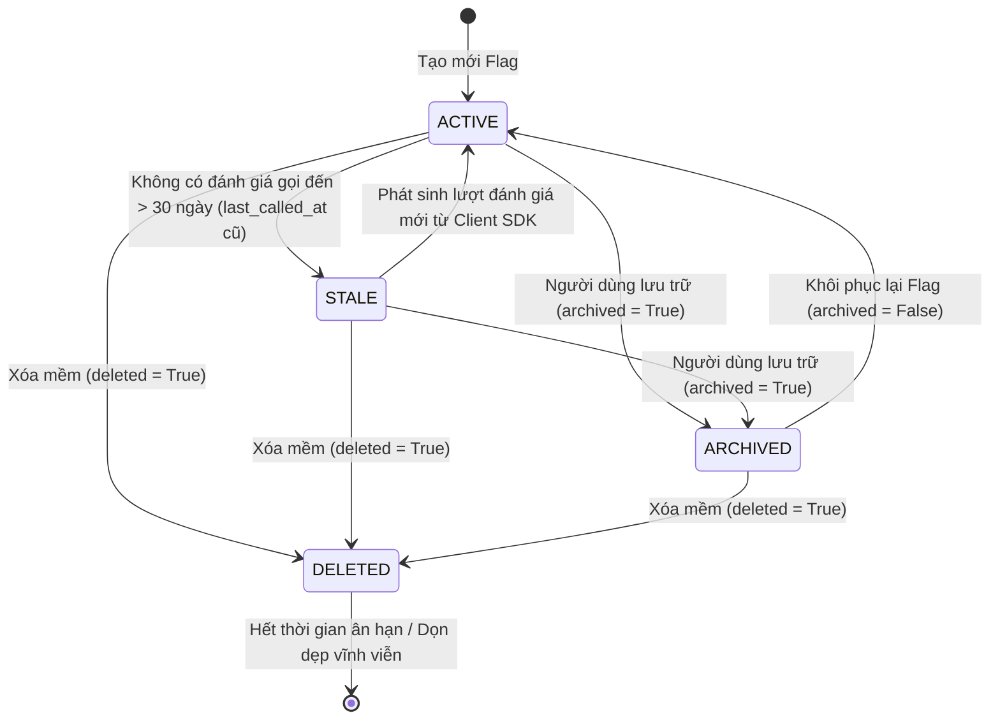
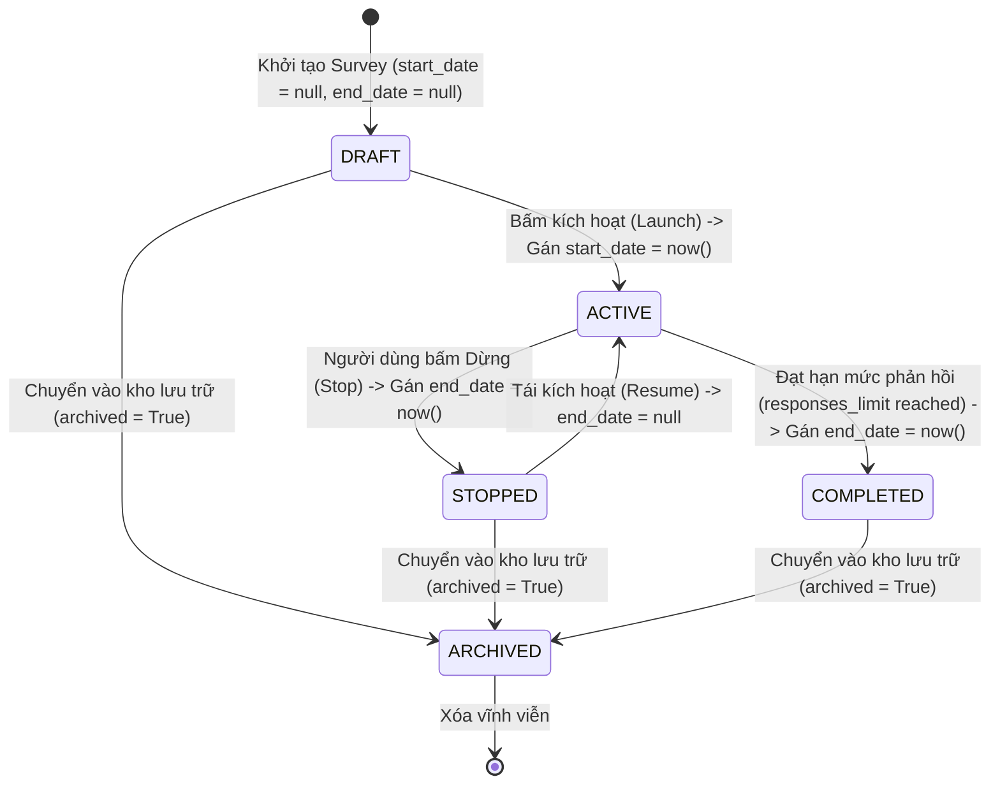
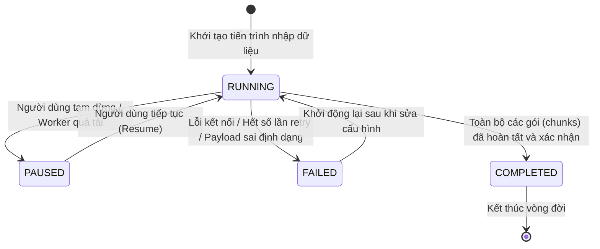

# HIẾN PHÁP NGHIỆP VỤ DỰ ÁN (PROJECT BUSINESS REQUIREMENTS CONSTITUTION)

> **Lời mở đầu:** Tài liệu này là **Bộ Luật Nghiệp Vụ Tối Cao (Source of Business Truth)** của toàn bộ dự án. Tài liệu thiết lập ranh giới sản phẩm, từ điển ngôn ngữ miền chung (*Ubiquitous Language*), máy trạng thái thực thể (*State Machines*), ma trận phân quyền (*RBAC*) và các bất biến nghiệp vụ bất khả xâm phạm (*Business Invariants*). Mọi kỹ sư phần mềm và AI Agents khi tham gia phát triển, bảo trì hoặc thiết kế tính năng mới đều **BẮT BUỘC** phải tuân thủ nghiêm ngặt hiến pháp này.

---

## Mục 1: Tầm Nhìn Sản Phẩm & Giá Trị Cốt Lõi (Product Vision & Core Domains)

### 1.1. Tầm Nhìn Sản Phẩm (Product Vision)
Dự án được xây dựng như một **Nền tảng Phân tích Sản phẩm & Dữ liệu Tất-Cả-Trong-Một (All-in-One Product Analytics & Developer Platform)** mã nguồn mở hàng đầu thế giới. 

Sản phẩm giải quyết triệt để bài toán phân mảnh công cụ của các doanh nghiệp hiện đại: thay vì phải tích hợp và duy trì 5–10 dịch vụ SaaS rời rạc (Mixpanel/Amplitude cho Product Analytics, LaunchDarkly cho Feature Flags, Hotjar cho Session Replay, Qualtrics cho In-App Surveys, Sentry/Datadog cho Error Tracking/Logs, Segment cho Customer Data Platform), dự án hợp nhất toàn bộ dữ liệu hành vi, giám sát kỹ thuật và trải nghiệm người dùng trên một nền tảng duy nhất với kho dữ liệu trung tâm (ClickHouse + PostgreSQL).

### 1.2. Chân Dung Người Dùng Mục Tiêu (Target Personas)
Hệ thống phục vụ 5 nhóm đối tượng cốt lõi:
1. **Product Managers (PM):** Theo dõi chuyển đổi người dùng qua Funnels, mức độ gắn bó qua Retention Charts, xu hướng hành vi qua Trends và thử nghiệm giả thuyết qua A/B Testing và In-app Surveys.
2. **Software & Systems Engineers:** Quản lý triển khai tính năng an toàn với Feature Flags đa biến thể, kiểm soát bán kính rủi ro (*blast radius*), giám sát lỗi ứng dụng (*Error Tracking & Crash Symbolication*), theo dõi vết phân tán (*Distributed Tracing*) và kiểm soát chi phí mô hình AI/LLM.
3. **Growth & Marketing Specialists:** Tối ưu hóa phễu đăng ký, phân khúc tập người dùng (*Dynamic Cohorts*), phân tích truy cập web không phụ thuộc cookie (*Cookieless Web Analytics*) và kích hoạt tương tác đa kênh qua Customer Data Platform (CDP).
4. **Data Engineers & Data Analysts:** Thực thi truy vấn phân tích sâu với ngôn ngữ HogQL trực tiếp trên hàng tỷ sự kiện, kết nối kho dữ liệu đối tác (*Data Warehouse*) và xuất dữ liệu định kỳ (*Batch Exports*).
5. **Security & Compliance Officers:** Kiểm soát phân quyền truy cập tài nguyên (*RBAC*), thực thi xác thực hai yếu tố (*2FA Enforcement*), đối chiếu nhật ký thao tác (*Audit Logging*) và đảm bảo quyền được quên theo chuẩn GDPR qua cơ chế xóa khóa mã hóa (*Crypto-shredding*).

### 1.3. Bản Đồ Phân Hệ Sản Phẩm Cốt Lõi (Vertical Slices / Core Domains)



---

## Mục 2: Từ Điển Ngôn Ngữ Miền Chung (Domain Ubiquitous Language & Entity Glossary)

Mọi tài liệu thiết kế, giao diện, API và mã nguồn bắt buộc phải sử dụng chính xác các thuật ngữ miền được quy định dưới đây. Tuyệt đối không tự ý dùng các từ đồng nghĩa gây nhầm lẫn ranh giới nghiệp vụ.

### 2.1. Cấu Trúc Khách Hàng Đa Tầng (Multi-Tenancy Hierarchy)

| Thực Thể (Entity) | Cấp Độ (Scope) | Định Nghĩa Nghiệp Vụ Chuẩn Xác | Mối Quan Hệ (Relationships) |
| :--- | :--- | :--- | :--- |
| **Organization** | Khách Hàng Pháp Nhân (Account-level) | Đại diện cho một công ty hoặc pháp nhân thương mại trả phí. Quản lý gói cước (*Billing Subscription*), hạn mức tài nguyên (*Quotas*), cấu hình bảo mật (*2FA, SAML/SSO*), điều khoản AI (*AI Terms*) và cấp độ chạy Plugin (`NONE`, `CONFIG`, `INSTALL`, `ROOT`). | Sở hữu `1..N` Teams/Projects; chứa `1..N` Users thông qua `OrganizationMembership`. |
| **Team / Project** | Phân Vùng Dữ Liệu (Data-level) | Phân vùng dữ liệu cô lập tuyệt đối (*Isolated Data Boundary*). Mỗi Team sở hữu một `api_token` độc nhất để nạp dữ liệu. Dữ liệu sự kiện, bảng phân tích, cờ tính năng không bao giờ được chia sẻ giữa các Team nếu không có thao tác liên kết tường minh. | Thuộc về đúng `1` Organization; sở hữu toàn bộ Events, Insights, Feature Flags, Surveys, Replays của dự án đó. |
| **User** | Danh Tính Cá Nhân | Cá nhân đăng nhập vào hệ thống với địa chỉ email duy nhất và mật khẩu/SSO. Một User có thể tham gia nhiều Organization với vai trò khác nhau. | Có `1..N` `OrganizationMembership`. Có `current_organization` và `current_team` tại mỗi phiên làm việc. |
| **OrganizationMembership** | Quan Hệ Thành Viên | Bản ghi xác thực cấp bậc quyền hạn của một User trong một Organization cụ thể (`MEMBER = 1`, `ADMIN = 8`, `OWNER = 15`). | Liên kết `1` User với `1` Organization. |

### 2.2. Dữ Liệu Phân Tích & Định Danh (Analytics & Identity Entities)

| Thực Thể (Entity) | Bản Chất Lưu Trữ | Định Nghĩa Nghiệp Vụ Chuẩn Xác | Quy Tắc Nghiệp Vụ |
| :--- | :--- | :--- | :--- |
| **Event** | ClickHouse (`sharded_events`) | Điểm dữ liệu bất biến phản ánh một hành động đã xảy ra tại thời điểm `timestamp` (ví dụ: `$pageview`, `button_clicked`). Gồm tên sự kiện, danh tính tạm thời `distinct_id` và gói thuộc tính `properties` (JSON). | Bất biến (Append-only). Luôn gắn chặt với `team_id`. |
| **Distinct ID** | Redis / ClickHouse / Identity DB | Chuỗi định danh thiết bị, cookie hoặc tài khoản người dùng gửi lên từ SDK. Một người dùng có thể có nhiều `distinct_id` qua thời gian (trước và sau khi đăng nhập). | Được ánh xạ về `Person` thông qua RPC Service. |
| **Person** | Identity RPC (`PersonHog`) | Thực thể đại diện cho một con người có thực đằng sau chuỗi sự kiện. Sở hữu tập thuộc tính tích lũy (`PersonProperties`: email, name, plan...). | Chỉ được thao tác qua `PersonHog RPC Client`. Cấm hợp nhất 2 Person thuộc 2 Team khác nhau. |
| **Cohort** | PostgreSQL / ClickHouse | Phân khúc tập người dùng thỏa mãn điều kiện xác định. Có 2 dạng: *Dynamic Cohort* (tự động tính toán lại theo thuộc tính sự kiện/người dùng) và *Static Cohort* (danh sách ID tĩnh nạp từ CSV). | Tái sử dụng làm điều kiện nhắm mục tiêu cho Feature Flags, Surveys và Funnels. |
| **Group** | ClickHouse / Identity DB | Thực thể đại diện cho tổ chức hoặc khách hàng doanh nghiệp B2B (Company, Workspace, Account), cho phép phân tích hành vi theo cấp độ tập thể bên cạnh cấp độ cá nhân. | Mỗi sự kiện có thể gắn tối đa 5 loại nhóm khác nhau. |
| **Action** | PostgreSQL / HogQL | Nhóm logic gồm nhiều sự kiện khác nhau đại diện cho một mục tiêu nghiệp vụ (ví dụ: "Người dùng đăng ký thành công" gộp từ sự kiện Webhook, URL visit và Click button). | Dùng trong Funnel và tính toán chuyển đổi tự động. |

### 2.3. Báo Cáo & Khám Phá Dữ Liệu (Reporting & Delivery)

| Thực Thể (Entity) | Định Nghĩa Nghiệp Vụ | Quan Hệ Nghiệp Vụ |
| :--- | :--- | :--- |
| **Insight** | Một bản phân tích trực quan hóa cụ thể (Trends, Funnels, Retention, User Paths, Lifecycle hoặc HogQL query). | Thuộc về `1` Team; có thể được gắn vào `0..N` Dashboards; có thể lưu lịch sử truy vấn. |
| **Dashboard** | Bảng điều khiển tập trung chứa nhiều thẻ Insights, hỗ trợ bộ lọc ngày tháng toàn cục, thẻ phân loại (Tags) và chế độ chia sẻ công khai qua đường dẫn bí mật. | Thuộc về `1` Team; liên kết `1..N` Insights; có thể gắn lịch gửi báo cáo tự động qua Subscriptions. |
| **Subscription** | Tác vụ tự động hóa lên lịch xuất báo cáo (Insight hoặc Dashboard) gửi đến các kênh truyền thông (Email, Slack, Microsoft Teams) theo tần suất định kỳ. | Thuộc về `1` Team; liên kết `1` Insight hoặc `1` Dashboard; giới hạn theo gói dịch vụ (Free tier limit). |

### 2.4. Can Thiệp Trải Nghiệm & Giám Sát (Experience & Control Entities)

| Thực Thể (Entity) | Định Nghĩa Nghiệp Vụ | Quan Hệ Nghiệp Vụ |
| :--- | :--- | :--- |
| **Feature Flag** | Công tắc điều khiển việc phát hành mã nguồn, phân bổ biến thể (*Variants*) hoặc phân tách lưu lượng theo điều kiện lọc người dùng/tỷ lệ phần trăm. | Thuộc về `1` Team; liên kết trực tiếp với Surveys, Experiments, Early Access Features. |
| **Survey** | Khảo sát tương tác trực tiếp trên giao diện người dùng (Popover, Widget) hoặc gọi qua API. Chứa danh sách câu hỏi hỗ trợ rẽ nhánh logic và đa ngôn ngữ. | Thuộc về `1` Team; tự động sinh và điều khiển `targeting_flag` để chọn đối tượng hiển thị. |
| **Session Recording** | Bản ghi video tái tạo phiên duyệt web/mobile dựa trên các gói snapshot DOM của chuẩn RRWeb. Chứa sự kiện chuột, cuộn màn hình, network logs và console errors. | Thuộc về `1` Team; được bảo vệ bằng cơ chế mã hóa và hủy khóa (*Crypto-shredding*) khi có yêu cầu xóa dữ liệu. |
| **Batch Import** | Tiến trình nhập dữ liệu lịch sử quy mô lớn từ hệ thống phân tích bên ngoài (Mixpanel, Amplitude) vào hệ thống theo cơ chế chia nhỏ lô (*Chunks & Leases*). | Thuộc về `1` Team; thực thi đơn nhiệm (Mỗi Team chỉ được phép có tối đa 1 tiến trình Running). |

### 2.5. Sơ Đồ Quan Hệ Thực Thể Cốt Lõi (Domain Entity-Relationship Diagram)



### 2.6. Bảng Chuẩn Hóa Thuật Ngữ (Canonical Vocabulary vs. Anti-patterns)

| Thuật Ngữ Chuẩn (CANONICAL) | Thuật Ngữ CẤM DÙNG (ANTI-PATTERN) | Lý Do Nghiệp Vụ |
| :--- | :--- | :--- |
| `Organization` | `Company`, `Tenant`, `Account` | Organization là đơn vị pháp nhân duy nhất quản trị tài khoản và thanh toán. |
| `Team` hoặc `Project` | `Workspace`, `App`, `Sub-account` | Team và Project là khái niệm tương đương trong mã nguồn; biểu thị ranh giới cô lập dữ liệu. |
| `Distinct ID` | `User ID`, `Device Hash`, `Client ID` | Distinct ID có thể là ID ẩn danh hoặc đã xác thực; phân biệt rõ với UUID của Person. |
| `Person` | `Profile`, `Customer`, `End-user` | Person là thực thể danh tính đã qua xử lý hợp nhất (Identity Resolution). |
| `Feature Flag` | `Toggle`, `Config Switch`, `Gate` | Feature Flag biểu thị công tắc tính năng hoàn chỉnh có đánh giá điều kiện và rollout. |
| `Session Recording` | `Session Replay Video`, `Screen Capture` | Đây không phải video MP4/WebM mà là chuỗi sự kiện snapshot RRWeb được render động. |

---

## Mục 3: Vòng Đời Thực Thể & Máy Trạng Thái (Entity State Machines & Transitions)

Mọi thay đổi dữ liệu của các thực thể cốt lõi phải tuân thủ nghiêm ngặt các máy trạng thái sau. Mọi hành động kích hoạt chuyển trạng thái trái phép phải bị từ chối và trả về lỗi phù hợp.

### 3.1. Máy Trạng Thái Của Feature Flag (Feature Flag State Machine)

Một Feature Flag có vòng đời hoàn chỉnh từ lúc tạo mới, phát hành, đánh giá độ ổn định, đến khi lưu trữ hoặc gỡ bỏ:



#### Các trạng thái Rollout (Rollout States):
- `ROLLOUT_NOT_ROLLED_OUT` (0%): Cờ đang tắt hoàn toàn hoặc chưa áp dụng điều kiện cho bất kỳ ai.
- `ROLLOUT_PARTIAL` (1% – 99%): Cờ đang được phân phối có điều kiện (theo danh sách người dùng, theo thuộc tính, hoặc chia theo tỷ lệ phần trăm).
- `ROLLOUT_FULLY_ROLLED_OUT` (100%): Cờ phát hành toàn bộ cho 100% người dùng mà không có điều kiện lọc nào.

> [!WARNING]
> **Điều Luật Cấm Kỵ Về Feature Flag:**
> 1. Tuyệt đối **CẤM XÓA** (`DELETED`) một Feature Flag nếu cờ đó đang được gán làm `linked_flag` hoặc `targeting_flag` của một Survey đang hoạt động (`ACTIVE`). Thao tác xóa cờ phải bị chặn và yêu cầu người dùng gỡ liên kết khỏi Survey trước.
> 2. Các cờ ở trạng thái `ARCHIVED` mặc định bị ẩn khỏi các danh sách truy vấn API thông thường, trừ khi yêu cầu chỉ định rõ tham số `archived=true`.

---

### 3.2. Máy Trạng Thái Của Khảo Sát (Survey State Machine)

Khảo sát người dùng được quản lý thông qua các mốc thời gian `start_date`, `end_date` và cờ `archived`:



#### Ma trận Hành Động Theo Trạng Thái Khảo Sát:

| Trạng Thái Khảo Sát | Sửa Cấu Trúc Câu Hỏi | Nhận Phản Hồi Từ SDK | Cờ Feature Flag Tương Ứng |
| :--- | :--- | :--- | :--- |
| **DRAFT** | Cho phép toàn quyền chỉnh sửa | BỊ CẤM (Không phát tán) | Tắt (`is_active = False`) |
| **ACTIVE** | CẤM sửa đổi cấu trúc (chỉ sửa chữ mô tả) | Được phép nạp phản hồi | Bật (`is_active = True`) |
| **STOPPED / COMPLETED** | CẤM chỉnh sửa | BỊ CẤM (Từ chối ghi nhận mới) | Tắt (`is_active = False`) |
| **ARCHIVED** | Chỉ xem ở chế độ Read-only | BỊ CẤM | Tắt và ẩn khỏi danh sách chính |

---

### 3.3. Máy Trạng Thái Của Tiến Trình Nhập Dữ Liệu (Batch Import State Machine)

Tiến trình nhập dữ liệu lịch sử từ Mixpanel/Amplitude chịu sự kiểm soát khắt khe của hệ thống Distributed Worker:



> [!IMPORTANT]
> **Các Bất Biến Sống Còn Của Batch Import:**
> 1. **Bất biến Đơn Nhiệm (Single Running Import Invariant):** Tại một thời điểm, mỗi Team **CHỈ ĐƯỢC PHÉP CÓ DUY NHẤT 1 BATCH IMPORT** ở trạng thái `RUNNING` (`cannot create multiple running imports`). Yêu cầu tạo mới phải bị chặn với mã lỗi HTTP 400 nếu đang có import khác chạy dở.
> 2. **Chống Xung Đột Commit (Commit In-Flight Guard):** Khi một worker đang xử lý một chunk dở dang (`pending_commit` khác rỗng), cấm thao tác resume đột ngột; bắt buộc ném lỗi `CommitInFlightError` để tránh việc bỏ qua hoặc ghi đè dữ liệu.

---

### 3.4. Vòng Đời Đăng Ký Nhận Báo Cáo (Subscription Lifecycle)

- **ENABLED (Đang hoạt động):** Báo cáo được tính toán và gửi đi tự động theo biểu thức lặp `rrule` (Daily, Weekly, Monthly, Yearly).
- **PAUSED / AUTO-DISABLED (Tạm dừng):** Khi người dùng chủ động tắt hoặc hệ thống phát hiện kênh liên kết bên ngoài (Slack Webhook, Email Integration) bị mất quyền truy cập hoặc ngắt kết nối.
- **DELETED (Đã xóa):** Xóa mềm (`deleted = True`), hủy toàn bộ lịch trình gửi trong tương lai.

> [!NOTE]
> **Hạn mức Gói Miễn Phí (Free Tier Limit):**
> Mỗi Team thuộc gói miễn phí chỉ được tạo tối đa số lượng `SUBSCRIPTION_COUNT_ALLOWED_ON_FREE_TIER` Subscriptions. Khi đạt trần, API phải chặn hành động tạo mới và trả về thông báo nâng cấp gói thanh toán.

---

### 3.5. Cơ Chế Hủy Khóa Mã Hóa Replay (Session Encryption & Crypto-Shredding)

Bảo vệ quyền riêng tư người dùng theo quy định GDPR/CCPA:
- Mỗi phiên ghi hình nhạy cảm được mã hóa bằng khóa bí mật riêng biệt.
- **Quy trình Hủy Khóa (Crypto-Shredding):** Khi khách hàng hoặc người dùng yêu cầu xóa phiên/xóa dữ liệu cá nhân, hệ thống thực thi xóa khóa mã hóa phiên khỏi kho khóa KMS / Key Cache.
- **Quy tắc Bất Biến:** Sau khi khóa bị xóa:
  - Mọi nỗ lực giải mã hoặc ghi đè mã hóa phiên **BẮT BUỘC** phải ném ra ngoại lệ `SessionKeyDeletedError`.
  - **CẤM TUYỆT ĐỐI HỒI SINH PHIÊN ĐÃ HỦY (Never Resurrect Shredded Session):** Không bao giờ được tạo lại khóa mới để khôi phục phiên đã bị xóa.
  - Việc hủy khóa của Team này tuyệt đối không được làm ảnh hưởng đến khóa của các Team khác.

---

## Mục 4: Ma Trận Phân Quyền & Ranh Giới Nghiệp Vụ (RBAC & Business Invariants)

Hệ thống bảo vệ dữ liệu thông qua cơ chế phân quyền hai tầng: Cấp bậc vai trò Tổ chức (*Organization Role Levels*) kết hợp với Cấu hình kiểm soát quyền trên từng Tài nguyên (*Resource-Level Access Control*).

### 4.1. Ma Trận Phân Quyền Tổ Chức (Organization RBAC Matrix)

| Hành Động Nghiệp Vụ | Owner (Cấp 15) | Admin (Cấp 8) | Member (Cấp 1) | Guest / Restricted |
| :--- | :---: | :---: | :---: | :---: |
| **Xóa hoặc Đổi tên Organization** | ✅ | ❌ | ❌ | ❌ |
| **Quản lý Hợp đồng & Thanh toán (Billing)** | ✅ | ❌ | ❌ | ❌ |
| **Chuyển giao quyền Owner** | ✅ | ❌ | ❌ | ❌ |
| **Mời, Sửa cấp bậc hoặc Xóa Thành viên** | ✅ | ✅ | ❌ | ❌ |
| **Tạo Team / Project mới** | ✅ | ✅ | Tùy chọn cấu hình (*) | ❌ |
| **Cấu hình Quy tắc Truy cập Tài nguyên (RBAC Policy)** | ✅ | ✅ | ❌ | ❌ |
| **Tạo và Quản lý Personal API Keys** | ✅ | ✅ | ✅ (Nếu được phép) | ❌ |
| **Tạo, Sửa Insights, Dashboards, Feature Flags** | ✅ | ✅ | ✅ (Mặc định) | Chỉ Xem |
| **Xem dữ liệu Session Replays nhạy cảm** | ✅ | ✅ | Theo phân quyền | ❌ |

(*) *Chỉ khi cờ `members_can_create_projects` của Organization được bật thì Member mới có quyền tạo Team mới.*

### 4.2. Quyền Kiểm Soát Tài Nguyên (Resource-Level Access Control)

Mỗi tài nguyên nhạy cảm (`feature_flags`, `dashboards`, `insights`, `cohorts`, `session_recordings`) được bảo vệ bởi 2 mức truy cập:
- **`CAN_ONLY_VIEW` (Cấp 21):** Người dùng hoặc Role chỉ được đọc dữ liệu; toàn bộ thao tác POST/PUT/PATCH/DELETE đều bị chặn với mã lỗi HTTP 403 Forbidden.
- **`CAN_ALWAYS_EDIT` (Cấp 37):** Người dùng hoặc Role có toàn quyền chỉnh sửa và cập nhật tài nguyên.

---

### 4.3. Các Bất Biến Nghiệp Vụ Bất Khả Xâm Phạm (The Absolute Business Invariants)

Đây là các điều răn tối thượng. Mọi đoạn code vi phạm bất kỳ điều nào dưới đây đều bị coi là lỗi bảo mật mức nghiêm trọng (P0/Critical):

```
+---------------------------------------------------------------------------------------+
|                       5 BẤT BIẾN NGHIỆP VỤ BẤT KHẢ XÂM PHẠM                           |
+---------------------------------------------------------------------------------------+
| 1. PHÂN LẬP TENANT TUYỆT ĐỐI (ZERO CROSS-TENANT DATA LEAKAGE)                         |
|    - Cấm tuyệt đối việc truy vấn dữ liệu không gắn với team_id / organization_id.     |
|    - Mọi API Endpoint và Query bắt buộc phải chặn đứng nguy cơ IDOR.                  |
+---------------------------------------------------------------------------------------+
| 2. NHẬT KÝ KIỂM TOÁN BẤT BIẾN (IMMUTABLE AUDIT LOGGING)                               |
|    - Mọi thay đổi trạng thái nhạy cảm (Flag, Role, Key, Survey) phải ghi ActivityLog.  |
|    - CẤM cung cấp API hoặc viết script xóa đè hoặc sửa đổi nội dung ActivityLog.      |
+---------------------------------------------------------------------------------------+
| 3. BẢO VỆ TOÀN VẸN DANH TÍNH (IDENTITY INTEGRITY BARRIER)                             |
|    - CẤM hợp nhất (merge) hai Person thuộc hai Team khác nhau.                        |
|    - Mọi truy vấn danh tính bắt buộc phải đi qua RPC Client (PersonHog).              |
+---------------------------------------------------------------------------------------+
| 4. KIỂM SOÁT HẠN MỨC TÀI NGUYÊN (BILLING QUOTA ENFORCEMENT)                           |
|    - Khi Organization vượt hạn mức tài nguyên (Quota Exceeded), hệ thống phải chặn    |
|      thao tác và trả về mã lỗi HTTP 402 Payment Required, không được nuốt lỗi âm thầm.|
+---------------------------------------------------------------------------------------+
| 5. BẢO VỆ PHIÊN ĐÃ HỦY KHÓA (CRYPTO-SHREDDING PERMANENCE)                             |
|    - Khi một phiên ghi hình đã bị xóa khóa mã hóa, CẤM TUYỆT ĐỐI việc tạo lại khóa     |
|      hoặc phục hồi dữ liệu phiên. Phải trả về lỗi SessionKeyDeletedError.             |
+---------------------------------------------------------------------------------------+
```

---

## Mục 5: Tiêu Chuẩn Soạn Thảo Feature Spec (Feature Spec Standard)

Khi có yêu cầu phát triển một tính năng mới hoặc chỉnh sửa lớn trong hệ thống, kỹ sư và AI bắt buộc phải soạn thảo một bản **Đặc Tả Tính Năng (Feature Spec)** theo đúng khung sườn 8 phần dưới đây trước khi bắt tay vào viết code.

### Khung Sườn Bắt Buộc Của Một Bản Feature Spec:

```markdown
# [FEATURE SPEC]: <Tên Tính Năng Ngắn Gọn>

## 1. Tổng Quan & Bối Cảnh Nghiệp Vụ (Context & Business Objectives)
- **Vấn đề cần giải quyết:** Người dùng đang gặp khó khăn gì? Hiện tượng nút thắt là gì?
- **Mục tiêu tính năng:** Tính năng này mang lại giá trị định lượng gì (ví dụ: tăng 15% tương tác khảo sát, giảm 30% thời gian tạo báo cáo)?
- **Phân hệ sở hữu (Owning Domain):** Thuộc Product nào (`products/<product_name>`)?

## 2. Chân Dung Người Dùng & Câu Chuyện Người Dùng (Target Personas & User Stories)
- **Đối tượng sử dụng:** (PM, Data Analyst, Engineer, Org Admin...)
- **User Stories (Chuẩn mực Agile):**
  - *Là một* [Vai trò người dùng],
  - *Tôi muốn* [Thực hiện hành động / thao tác cụ thể],
  - *Để mà* [Đạt được kết quả / giá trị nghiệp vụ mong đợi].

## 3. Ranh Giới Phạm Vi Tính Năng (Scope & Boundaries)
- **Phạm vi thực hiện (In-Scope):** Các màn hình, API, model dữ liệu chắc chắn sẽ làm trong đợt này.
- **Ngoài phạm vi (Out-of-Scope):** Những tính năng chưa làm ngay để tránh phình to dự án (Feature Creep).

## 4. Hợp Đồng Dữ Liệu & Giao Tiếp (Data Contracts & API Specifications)
- **Data Models / Schemas:** Cấu trúc bảng PostgreSQL hoặc bảng ClickHouse mới (Bắt buộc kế thừa `TeamScopedRootMixin`).
- **Frozen DTOs (Data Transfer Objects):** Định nghĩa cấu trúc dữ liệu truyền nhận bất biến (`@frozen`).
- **API Endpoints:**
  - `METHOD /api/projects/:project_id/<resource>/`: Mô tả payload gửi lên và cấu trúc JSON trả về.
  - Phân quyền bắt buộc: Quyền tối thiểu để gọi endpoint (`APIScopePermission`, Level Member/Admin).

## 5. Máy Trạng Thái & Luồng Dữ Liệu (State Machines & User Journeys)
- Sơ đồ chuyển đổi trạng thái của thực thể (nếu có vòng đời).
- Sơ đồ tuần tự (Sequence Diagram) từ Giao diện ➔ API ➔ Service/Facade ➔ Database/Workers.

## 6. Các Tình Huống Biên & Xử Lý Ngoại Lệ (Edge Cases & Resilience)
- **Tình trạng dữ liệu rỗng (Empty States):** Hiển thị thế nào khi chưa có bản ghi nào?
- **Xử lý trùng lặp & Đua tranh (Idempotency & Concurrency):** Cách chống gửi yêu cầu kép (Double Submission), xử lý khóa lạc quan (*Optimistic Locking*).
- **Vượt hạn mức (Quota Limit):** Ứng xử ra sao khi tổ chức của khách hàng đã cạn kiệt tài nguyên?
- **Mất kết nối / Timeout:** Cơ chế phục hồi khi các dịch vụ phụ trợ (Redis, Kafka, ClickHouse) phản hồi chậm.

## 7. Ràng Buộc Kiến Trúc & An Toàn Nghiệp Vụ (Architecture & Invariant Compliance)
- Xác nhận tuân thủ Multi-tenancy: Truy vấn đã được lọc theo `team_id` chưa?
- Xác nhận an toàn danh tính: Có gọi qua `PersonHog RPC` thay vì query ORM bảng person không?
- Xác nhận ghi log kiểm toán: Có phát tín hiệu `ActivityLog` khi thay đổi dữ liệu nhạy cảm không?

## 8. Tiêu Chí Nghiệm Thu Rõ Ràng (Acceptance Criteria - Gherkin Syntax)
- **Kịch bản 1: Luồng thành công chính (Happy Path)**
  - *Given (Cho trước):* Người dùng là Admin của Team 1 và đang ở trang cấu hình.
  - *When (Khi):* Người dùng nhập đầy đủ thông tin hợp lệ và nhấn "Lưu".
  - *Then (Thì):* Bản ghi mới được tạo gắn với Team 1, phản hồi mã HTTP 201 Created và giao diện hiển thị thông báo thành công.
- **Kịch bản 2: Luồng kiểm tra phân quyền (Security Path)**
  - *Given:* Người dùng là Member có quyền `CAN_ONLY_VIEW`.
  - *When:* Người dùng cố tình gửi request POST để tạo bản ghi.
  - *Then:* Hệ thống từ chối với mã lỗi HTTP 403 Forbidden và ghi log cảnh báo.
- **Kịch bản 3: Luồng chặn rò rỉ dữ liệu (Multi-Tenant Isolation)**
  - *Given:* Người dùng thuộc Team 1 cố tình truy vấn tài nguyên có ID thuộc sở hữu của Team 2.
  - *Then:* Hệ thống trả về mã lỗi HTTP 404 Not Found (tuyệt đối không để lộ dữ liệu tồn tại).
```

---

> [!TIP]
> **Hướng Dẫn Sử Dụng Trong Quy Trình Tự Động Hóa:**
> Khi người dùng yêu cầu: *"Hãy viết đặc tả cho tính năng X"* hoặc *"Dùng skill write-requirement-feature để thiết kế Y"*, AI phải đối chiếu ngay lập tức với **Mục 2 (Từ điển Ubiquitous Language)**, **Mục 3 (Máy trạng thái)** và **Mục 4 (Ma trận phân quyền & Bất biến)** của tài liệu này để điền vào **Khung sườn Mục 5**. Tuyệt đối không được sáng tác ra các khái niệm nghiệp vụ trái ngược với Hiến Pháp này!
